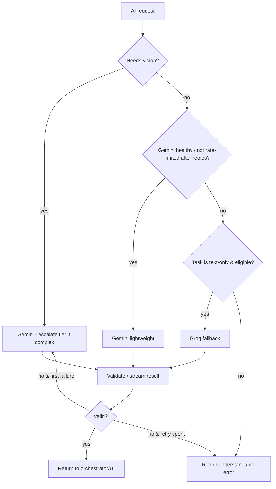
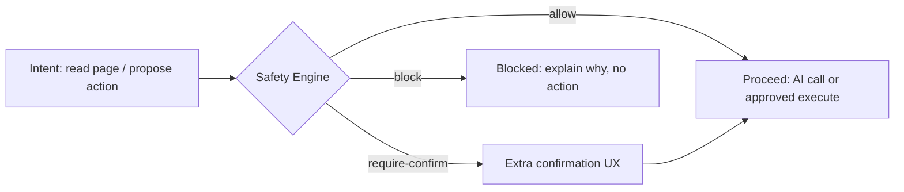
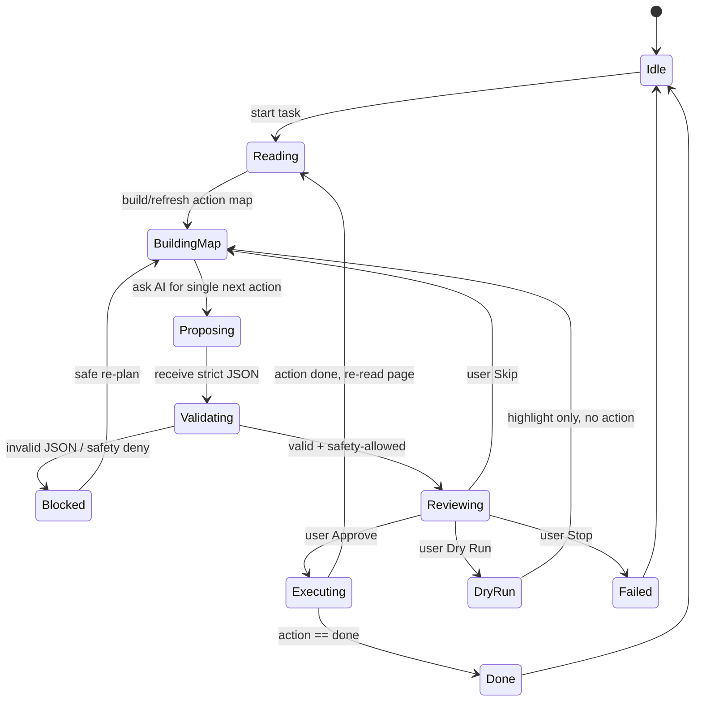
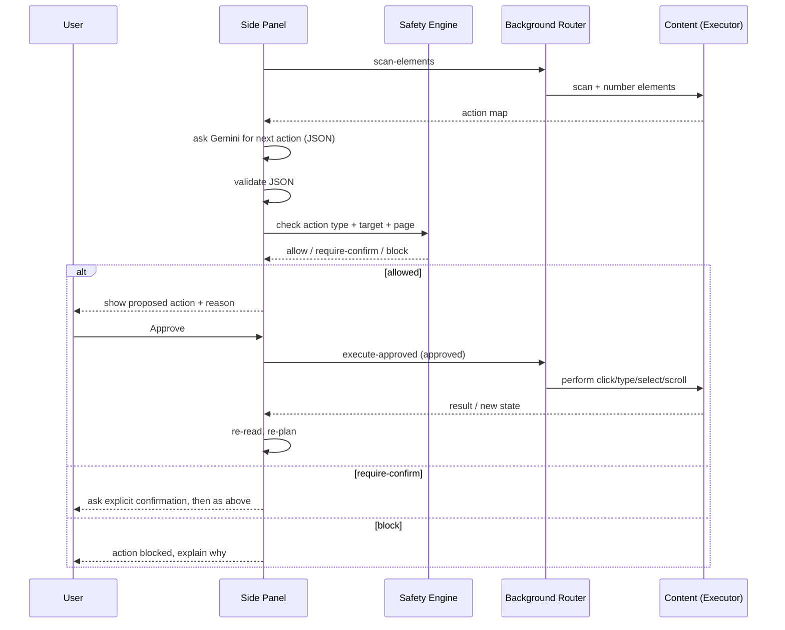

# Sahayak – Architecture Document

**AI-Powered Chrome Side-Panel Browser Assistant**

This document describes the software architecture for **Sahayak**. It is a design reference, not an implementation guide: it contains no application code, only architectural structure, responsibilities, contracts, and data flow. It is derived directly from [`problemStatement.md`](./problemStatement.md) and satisfies Technical Constraints (§5), Development Rules (§8), and the Functional/Non-Functional Requirements (§3–§4).

---

## 1. Purpose and Scope

Sahayak is a Chrome extension that reads the page the user is viewing, answers questions grounded in that page, understands screenshots, identifies interactive elements, and helps complete browser tasks **one approved step at a time**. It keeps a local user profile and reusable prompt skills, and enforces safety rules deterministically in code.

**Architectural goals (priority order):** correctness → safety → maintainability → professional UX → cost.

**In scope:** Chrome desktop extension, Manifest V3, Side Panel UI, Gemini (primary AI), Groq (text-only fallback), Readability.js article extraction, local storage, content-script page reading and approved actions.

**Out of scope (from §6):** mobile, autonomous execution without approval, banking/payment automation, login/OTP/password/card automation, sending private pages to free-tier AI, risky automation on arbitrary third-party sites, Chrome Web Store publication.

---

## 2. Architecture at a Glance

Sahayak is deliberately **backend-free**. Every capability runs inside the browser process model. The single most important rule shapes the whole design:

> **All AI network calls live in the Side Panel. Content scripts never hold or see API keys.**

The system is organised into five layers:

| Layer | Location | Concern |
|---|---|---|
| **Surface** | Side Panel (extension page) | UI, intent capture, chat, review, approval |
| **Intelligence** | Side Panel modules | Provider clients, prompts, orchestration, summarisation |
| **Coordination** | Background service worker | Lifecycle, tab binding, context menus, message routing, badge overlays |
| **Page Interaction** | Content scripts (isolated world) | DOM extraction, element scanning, screenshot capture, approved action execution |
| **Governance & State** | Safety module + `chrome.storage` | Deterministic policy gate, profile/skills/session persistence |

### 2.1 Mermaid Architecture Diagram

```mermaid
graph TD
    subgraph UP["User Page Context"]
        UP1["Webpage DOM / YouTube player / Screenshot"]
    end

    subgraph EXT["Sahayak Extension - No Backend"]
        subgraph SP["Side Panel - extension process - ONLY place with API keys"]
            UI["Panel UI: chat, review, approval, settings, profile, skills"]
            ORCH["Agent Orchestrator - one-step state machine"]
            SUM["Summarisation Service - Readability + Gemini"]
            PROV["Provider Abstraction Layer"]
            GEM["Gemini Client - primary"]
            GROQ["Groq Client - text-only fallback"]
            REL["Reliability: retry, backoff, tier escalation, streaming"]
            SAFE["Safety Policy Engine - deterministic, pure"]
            STORE["State & Storage Manager"]
        end

        subgraph BG["Background Service Worker - ephemeral"]
            ROUTER["Message Router"]
            LIFE["Tab / Panel Lifecycle Binder"]
            CTX["Context Menu Controller"]
        end

        subgraph CS["Content Scripts - isolated world, NO keys"]
            READ["Article Reader - Readability.js"]
            SCAN["Interactive Element Scanner"]
            MAP["Action-Map Builder"]
            EXEC["Action Executor - approved actions only"]
            SHOT["Tab Capture / Cropping Driver"]
        end
    end

    subgraph EXTAPI["Chrome Extension APIs"]
        API1["sidePanel · tabs · scripting"]
        API2["contextMenus · action"]
        API3["storage.local · session · sync"]
        API4["tabs.captureVisibleTab"]
    end

    subgraph CL["External Cloud AI - free-tier"]
        CLOUD1["Gemini API"]
        CLOUD2["Groq API"]
    end

    UI --> ORCH
    UI --> SUM
    ORCH --> SAFE
    SUM --> SAFE
    ORCH --> PROV
    SUM --> PROV
    PROV --> GEM
    PROV --> GROQ
    PROV --> REL
    GEM --> CLOUD1
    GROQ --> CLOUD2
    ORCH --> STORE
    SUM --> STORE
    UI --> STORE
    STORE --> API3

    ROUTER <--> LIFE
    CTX --> ROUTER
    LIFE --> API1
    CTX --> API2

    UI <--> ROUTER
    ROUTER <--> EXEC
    EXEC --> API1

    ROUTER <--> READ
    ROUTER <--> SCAN
    ROUTER <--> SHOT
    READ --> API1
    SCAN --> API1
    SHOT --> API4

    READ --> UP1
    SCAN --> UP1
    EXEC --> UP1
    SHOT --> UP1
    SAFE --> API3

    classDef keyfill fill:#1f6feb,stroke:#0b3d91,color:#fff;
    classDef csfill fill:#fb8500,stroke:#a8560b,color:#111;
    classDef bgfill fill:#4361ee,stroke:#23308f,color:#fff;
    classDef clfill fill:#6c757d,stroke:#343a40,color:#fff;
    class GEM,GROQ,PROV keyfill;
    class READ,SCAN,MAP,EXEC,SHOT csfill;
    class ROUTER,LIFE,CTX bgfill;
    class CLOUD1,CLOUD2 clfill;
```



*Solid containment = in-browser boundary. Only the Provider Abstraction Layer (inside the Side Panel) crosses to external cloud AI; content scripts never touch keys.*

---

## 3. Process Model and Component Responsibilities

Chrome MV3 gives three distinct execution environments. Sahayak assigns responsibility by trust and lifetime.

### 3.1 Side Panel (primary component)

The user-facing extension page registered via the **Side Panel API**. It is a persistent-enough document where the user works alongside the page.

**Owns:**
- The **only** copy of API keys (entered in Settings, held in `chrome.storage`).
- All **AI provider calls** (Gemini primary, Groq fallback) and all prompt construction.
- The **Agent Orchestrator** state machine (§7) and the review/approval UX.
- The **Summarisation Service**, **Page-Chat**, **Screenshot-and-Ask** flows, and language toggle (English/Hinglish).
- Reads/writes to all storage tiers via the State & Storage Manager.
- Profile and Skills management UI.

**Never does:** direct DOM manipulation of the user page (delegated to content scripts); holding secrets in any form reachable by page scripts.

### 3.2 Background Service Worker (coordinator)

Ephemeral; may be suspended at any time, so it holds **no authoritative state** (that lives in the Side Panel + `chrome.storage`). It is a thin coordinator.

**Owns:**
- **Lifecycle binding:** opening/registering the side panel, keeping the panel bound to the active tab.
- **Message router:** relaying requests/results between the Side Panel and content scripts (tabs ↔ scripted contexts).
- **Context Menu controller:** registering right-click items (*Explain this*, *Translate*, *Draft a reply*) and translating a click into a routed request to the Side Panel.
- Triggering badge/overlay rendering by instructing the content script to paint element badges.

**Never does:** perform AI calls; store API keys; decide policy.

### 3.3 Content Scripts (page-facing workers, isolated world)

Injected into web pages in the **isolated world**, which keeps page JavaScript from reading extension data. They are the extension's "eyes and hands" on the DOM but are **untrusted for policy** — every request they receive is pre-vetted by the Side Panel safety layer.

**Sub-modules:**
- **Article Reader:** runs **Mozilla Readability.js** over a cloned document to extract title + main content, stripping nav/ads/sidebars/footers (§2.3).
- **Interactive Element Scanner:** enumerates supported elements (buttons, links, inputs, textareas, selects, checkboxes, other action elements), assigns a **stable number per element for the current page state** (§2.12).
- **Action-Map Builder:** serialises scanned elements into a **compact structured action map** (number, type, visible text, label, placeholder, relevant attributes) — **never raw HTML** (§2.13).
- **Screenshot/Tab-Capture driver:** supports focus/crop/restrict of the relevant region before analysis; capture itself uses `tabs.captureVisibleTab` from the extension context (§2.10).
- **Action Executor:** performs **only** an action that has already passed validation **and** received explicit user approval (`click`, `type`, `select`, `scroll`). It never auto-acts.
- **Badge/Overlay renderer:** paints numbered overlays so the user can identify elements.

**Never does:** see API keys; call a cloud AI provider; make its own decision to act without an approved, validated command.

### 3.4 Trust boundaries

| Boundary | Rule enforced |
|---|---|
| Page JS ↔ Content script | Isolated world blocks page scripts from reading extension state. |
| Content script ↔ Side Panel | Content scripts receive only vetted, approved commands; return only structured data. |
| Side Panel ↔ Cloud AI | Only place keys exist; only place network egress to Gemini/Groq happens. |
| Any component ↔ Sensitive page | Safety Engine gates before read or action (§6). |

---

## 4. Manifest V3 Structure

The extension is described declaratively by the MV3 manifest. Architecturally the manifest wires together the components above:

| Manifest area | Architectural role |
|---|---|
| `manifest_version: 3` | Fixes the whole design to MV3 constraints (service worker lifetime, no persistent background page). |
| Side panel declaration | Registers the Side Panel document as the main interface (FR-1). |
| `background.service_worker` | Registers the ephemeral coordinator (§3.2). |
| `content_scripts` + `scripting` permission | Declarative + on-demand injection of the page-facing modules (§3.3). |
| `action` | Toolbar entry to open the panel. |
| `host_permissions` / `permissions` | Scoped to `tabs`, `scripting`, `storage`, `sidePanel`, `contextMenus`, `activeTab` — least privilege. `captureVisibleTab` for screenshots. |
| Readability.js as a content-script asset | Bundled library loaded into the isolated world for article extraction. |
| No `externally_connectable`, no CSP relaxation | Keeps attack surface minimal; keys never exposed to pages. |

> **Local install** is via Chrome's *Load unpacked* (§2.1); distribution is a GitHub Release ZIP (§2.21). No build backend, no server component.

---

## 5. Gemini and Groq Integration

AI access is hidden behind a **Provider Abstraction Layer** so the orchestrator and summariser request a *capability*, not a specific vendor endpoint.

### 5.1 Provider roles

| Provider | Role | Modalities |
|---|---|---|
| **Gemini** | Primary, default for every AI task | Text + vision (screenshots, charts, diagrams, forms, errors) |
| **Groq** | Fallback for **eligible text-only tasks** | Text only |

**Eligible for Groq fallback** (no images, page-grounded text): page-chat answers, translation, drafted replies, plain-text summaries, JSON action selection. **Never eligible:** screenshot understanding or any task that needs vision.

### 5.2 Model tiering and cost (§4.4, §2.11)

- **Lightweight Gemini model by default.**
- Escalate to a **stronger Gemini model only when necessary** — e.g. JSON validation failed on the lighter tier, ambiguous multi-step action choice, or a complex visual.
- The tier decision is a function of **task complexity + prior failure count**, not left to the model.

### 5.3 Reliability

The provider layer centralises resilience so UI/orchestration stay simple:

- Handle HTTP **429 rate limits** and other Gemini/Groq errors with **retry + exponential backoff** and bounded attempts.
- **Graceful degradation:** primary → fallback → understandable error message (never a crash).
- Treat unavailable APIs / network failure as first-class results surfaced to the panel (§2.11).
- **Streaming** token responses when the API allows (page-chat), rendered progressively in the panel (§2.8).

### 5.4 Grounded-response contract

- **Page-grounding:** answer using **only** provided page context; if the answer is absent from the page, the response must explicitly state that the page does not provide it (§2.8). This is enforced through prompt structure *and* validated at the orchestrator boundary.
- **Structured output:** the agent and "Find It for Me" return **strict JSON**, which is **validated before use** (§4.1, NFR). Invalid JSON triggers re-ask on a higher tier, then a controlled failure — never blind execution.

### 5.5 Provider selection flow



---

## 6. Safety Policy Engine

Safety is a **pure, deterministic, independently testable module** placed early in the architecture, and **every page-read and every action path must pass it** (§8, §4.3). It does **not** rely on AI judgment.

### 6.1 Placement

The Safety Engine sits in the Side Panel between the orchestrator/summariser and any egress (network or content-script command). Conceptually it is a mandatory gate:



### 6.2 Deterministic rules (from §2.20)

| Rule | Enforcement |
|---|---|
| Block actions on banking/payment pages | Host/URL + page-classification allowlist/denylist checked in code |
| Never type into password fields | Field `type`/name/autocomplete inspection blocks `type` |
| Never type into OTP fields | Pattern detection on input context blocks `type` |
| Never type into card-information fields | Attribute/label heuristics block `type` |
| Extra confirmation for consequential actions | `Submit`, `Pay`, `Send` require an explicit second confirm |
| Immediate stop / kill switch | Panel + always-available Stop control halts the state machine |
| Keys never committed to public GitHub | Config/secrets kept out of source; documented limitation (§8 note) |
| Don't send private/sensitive pages to free-tier AI | Read-gate blocks sensitive pages before egress |
| Practice errands limited | Only provided practice environments or user-owned/controlled pages |
| Never automate login/payment/OTP/password | Hard-blocked action classes regardless of model output |

### 6.3 Design properties

- **Pure function:** given (page classification, target element, action type, value), returns `allow | require-confirm | block` deterministically — no network, no model, easily unit-tested.
- **Deny-biased:** unknown/risky defaults resolve to block or require-confirm.
- **Layered with approval:** safety blocking is independent of, and applied before, the user-approval requirement — both must pass.

---

## 7. Agent Orchestrator

The Agent Orchestrator is the Side Panel **state machine** implementing the ten-step, one-action-at-a-time workflow (§2.15) with its controls (§2.16).

### 7.1 State machine



### 7.2 Step contract

Each loop iteration: **read state → refresh map → propose one action → receive JSON → validate → safety-check → present action + reason → wait for decision → execute on approval → re-read → repeat** until `done` or user stops. Steps are strictly serialised; only one proposed action ever awaits approval at a time.

### 7.3 Action envelope (structured, validated)

| Field | Meaning |
|---|---|
| `type` | One of `click`, `type`, `select`, `scroll`, `done` |
| `target` | Element number from the action map (when applicable) |
| `value` | Text/option value (when applicable) |
| `reason` | Short human explanation of why this action is proposed |

Validation checks: allowed `type`, existing in-range `target`, `value` present iff required, `done` carries no target.

### 7.4 Controls and durability (§2.16)

- **Approve** → execute; **Skip** → discard safely and re-plan; **Stop** → halt immediately; **Dry Run** → highlight target only.
- **Max-step limit** prevents endless loops.
- **Action log** records every proposed action, reason, and user decision, shown in the panel.
- **Suspension durability:** approval state and task progress persist in `chrome.storage.session` (§8), so the ephemeral service worker can die without losing the agent's place. The Side Panel is the source of truth for session progress.

---

## 8. Communication and Data Flow

### 8.1 Message protocol (conceptual)

Communication uses Chrome runtime messaging routed by the background worker. Architecturally there are four request families, each carrying a small, structured payload (never bulk HTML):

| Family | Direction | Purpose |
|---|---|---|
| `extract-article` | Panel → (router) → content → back | Readability title + main text for summarisation |
| `scan-elements` | Panel → content → back | Numbered action map |
| `capture-screenshot` | Panel → (captureVisibleTab) → content crop → back | Cropped image for visual analysis |
| `execute-approved` | Panel → content | A single validated, approved, safety-cleared action |

Every inbound request to the content script for `execute-approved` must already carry an approval token produced by the panel's review step — the content script cannot originate actions.

### 8.2 Representative flow — Article summarisation

```mermaid
sequenceDiagram
    participant U as User
    participant P as Side Panel
    participant S as Safety Engine
    participant R as Background Router
    participant C as Content (Readability)
    participant G as Gemini
    U->>P: "Summarise this article"
    P->>S: check page not sensitive
    S-->>P: allow
    P->>R: extract-article request
    R->>C: inject/run Readability.js
    C-->>R: title + main content
    R-->>P: structured text
    P->>G: summarise (lightweight tier)
    G-->>P: TL;DR + 5 points + what to do next
    P-->>U: summary (English/Hinglish)
```

### 8.3 Representative flow — Approval-based action



### 8.4 "Find It for Me"

Natural-language query → analyse action map → Gemini returns strict JSON selection → validate → **highlight only, never click** (§2.14). The highlight path uses the badge/overlay renderer, not the executor.

---

## 9. Storage and State Design

Three tiers map data to the right lifetime and visibility (§2.18, §4.2, §8 rules):

| Tier | Contents | Lifetime | Rationale |
|---|---|---|---|
| `chrome.storage.local` | User profile (name, college, skills, links, preferred language, tone), saved skills, Gemini/Groq keys, settings | Persists on device | Local-only privacy; profile stays local unless user opts to share (§2.18) |
| `chrome.storage.session` | Approval state, agent task progress, current action map/step counters, action log buffer | Cleared on browser restart; survives service-worker suspension | Keeps agent resumable without persisting sensitive progress to disk (§8) |
| `chrome.storage.sync` | Small, non-secret prefs (e.g. language toggle) | Cross-device | Only trivial, public-safe settings |

**State ownership:** the **Side Panel** owns authoritative runtime state; the **service worker is stateless** and re-reads `chrome.storage.session` on wake. Skills support **import/export via local files** (§2.19).

**Key-security caveat (§5 note):** keys stored for a distributed extension are *not* truly secret — users can inspect extension files/runtime. The architecture stores keys in `chrome.storage.local`, keeps them **out of source control**, confines them to the Side Panel, and **documents this limitation** rather than pretending storage is an encrypted vault.

---

## 10. Feature Modules Mapped to Architecture

| Capability | Owning component(s) | Key contract |
|---|---|---|
| Selected-text explanation | Context menu → Panel → Gemini | Explain selection in panel (§2.2) |
| Article extraction + summary | Content Reader + Panel Summariser | TL;DR + 5 points + next actions (§2.3–2.4) |
| YouTube summarisation | Panel + content (transcript/timestamps) | Chapter-style notes w/ timestamps; graceful "cannot summarise" for inaccessible; private out of scope (§2.5) |
| Language toggle | Panel state | English ↔ Hinglish (§2.6) |
| Optional offline | Panel feature-detect Chrome built-in AI | Opportunistic, never blocks core (§2.7) |
| Page chat | Panel + history + streaming | Page-grounded only; "page doesn't say" (§2.8) |
| Context actions | Background CTX + Panel | Explain / Translate / Draft reply (email, LinkedIn, forum) (§2.9) |
| Screenshot-and-Ask | Content capture + Panel vision | Focus/crop region, Gemini vision (§2.10) |
| Interactive scanner + map | Content scan + map builder | Stable numbering, compact map, no raw HTML, refresh on change (§2.12–2.13) |
| Find It for Me | Panel + highlight | Strict JSON selection, highlight only (§2.14) |
| Approval agent | Panel orchestrator | §7 state machine + controls |
| Local profile | Storage manager | Reuse in forms/drafts, local by default (§2.18) |
| Reusable skills | Panel + storage | Create/save/reuse/import/export recipes (§2.19) |
| Safety enforcement | Safety Engine | Deterministic gates (§6) |
| Distribution | Repo + docs + Release ZIP + Pages | No code here; §2.21 deliverables |

---

## 11. Delivery Sequencing (four-week slice map)

Architecture is built slice-by-slice; each slice must run in Chrome and pass acceptance before the next begins (§8).

| Week | Slice | Architectural layers introduced |
|---|---|---|
| **1 – Eyes** | Foundation, selected-text, article extract + summarise, YouTube, language toggle | MV3 manifest, Side Panel, background coordinator, content Readability, Gemini lightweight client, basic settings/storage |
| **2 – Brain** | Page chat, context actions, screenshot-and-ask, API reliability | Provider abstraction + Groq fallback, streaming, retry/backoff/tiering, capture driver, conversation state |
| **3 – Hands** | Element scanner, action map, Find-It, approval agent, controls | Orchestrator state machine, action-envelope validation, executor, badge overlay, session persistence, action log |
| **4 – Ship** | Profile, skills, **Safety Engine hardening**, distribution | Storage tiers finalised, pure safety module enforced on every path, export/import, docs/release tooling |

> The **Safety Engine is designed from Week 1 but hardened/completed in Week 4**; per §8 it must be a pure testable module early, and every later read/action path must already route through it.

---

## 12. Non-Functional Design

- **Reliability (§4.1):** validated JSON before use; retry/backoff; session persistence across suspension; invalid actions refused by validation + safety.
- **Privacy (§4.2):** keys out of source; profile local; minimal necessary page content sent; sensitive pages blocked before egress.
- **Safety (§4.3):** no action without approval; deterministic deny-biased gates; extra confirm for consequential actions; always-visible Stop.
- **Cost (§4.4):** lightweight default model, escalation only when needed, fallback only for eligible text tasks, free-tier-first.
- **Usability (§4.5):** easy panel access, understandable errors, clear proposed-action display, obvious approve/skip/stop/dry-run.

---

## 13. Constraints, Risks, and Mitigations

| Risk | Mitigation |
|---|---|
| Service-worker suspension loses agent state | Authoritative state in Side Panel + `chrome.storage.session`; worker stateless |
| Raw HTML flooding the model / cost | Action-map is compact; only necessary content sent; no full-document egress |
| Vision tasks wrongly routed to Groq | Eligibility gate: any image ⇒ Gemini only |
| Model emits invalid/unsafe JSON | Strict validation + safety gate + tier escalation on failure; never blind-execute |
| Keys perceived as secret but aren't | Explicit documented limitation; keys confined to panel; out of source control |
| Autonomous-action pressure vs. safety | Approval is architectural (executor requires approval token); deny-biased defaults |
| Sensitive pages sent to free-tier AI | Safety Engine read-gate before provider call |

---

## 14. Definition of Done Alignment

The architecture supports every §7 DoD item: install via Release ZIP + Load unpacked (§4); open panel + enter key (§3.1, §9); summarise article/YouTube (§2.4–2.5, §10); language toggle (§2.6); page-grounded chat (§2.8, §5.4); explain/translate/draft (§2.9); screenshot Q&A (§2.10); find + highlight (§2.14); approval agent with approve/skip/stop/dry-run + log (§7); profile + skills (§2.18–2.19); visible safety blocks (§6); self-serve docs (§2.21).

---

*End of architecture document. This file describes structure and contracts only; it contains no application code, per the task requirements.*
